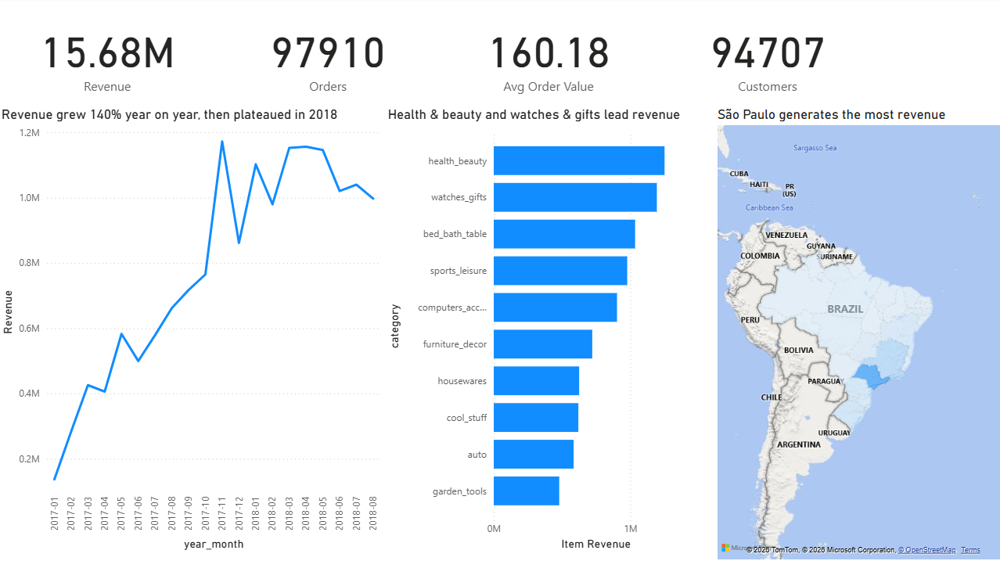
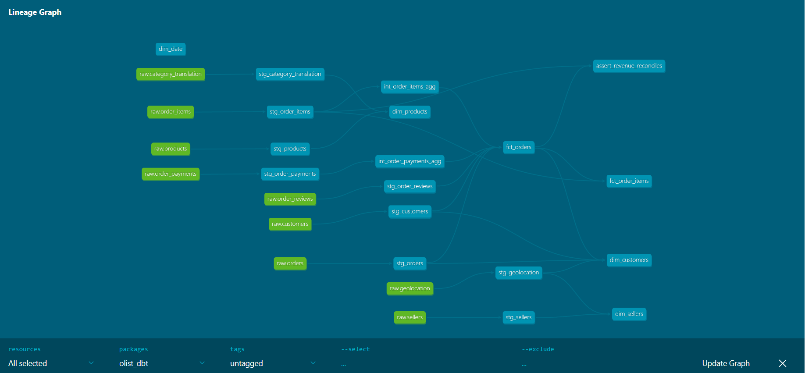
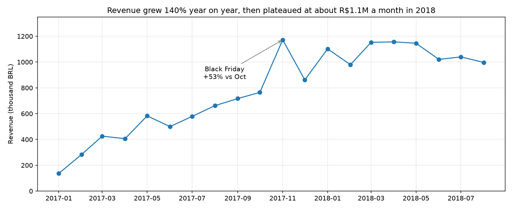
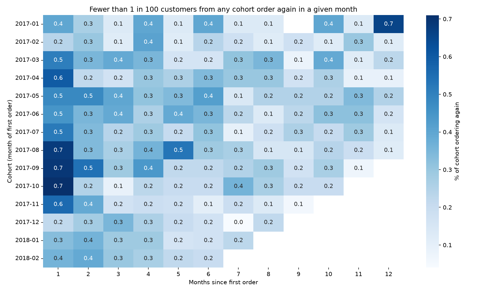
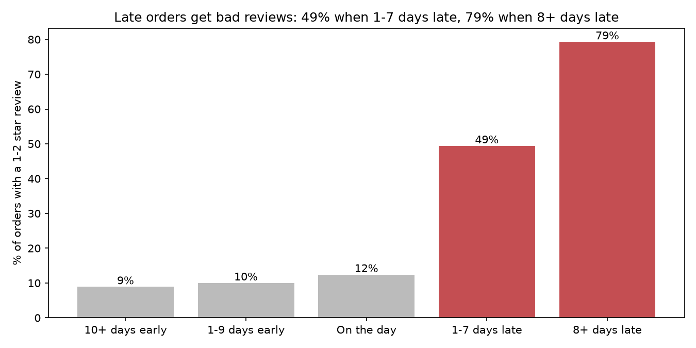
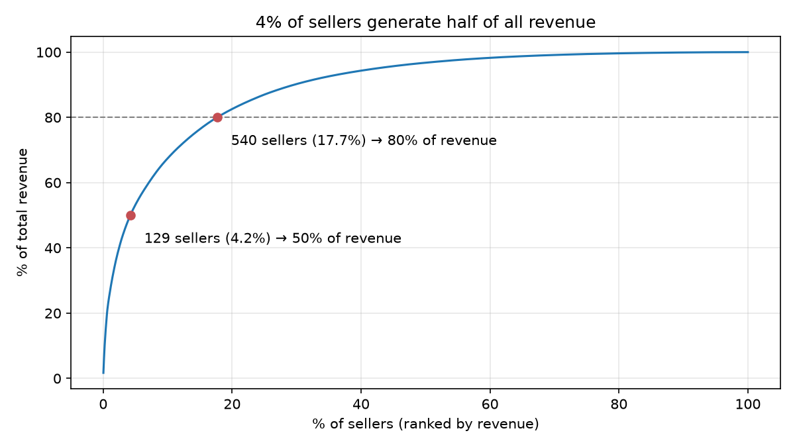
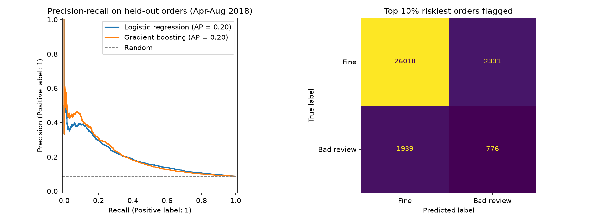
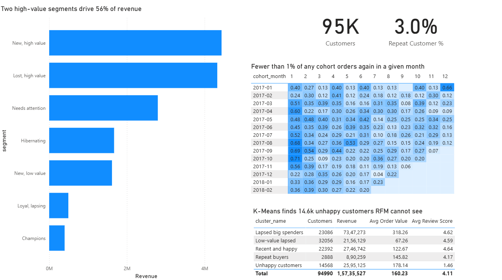
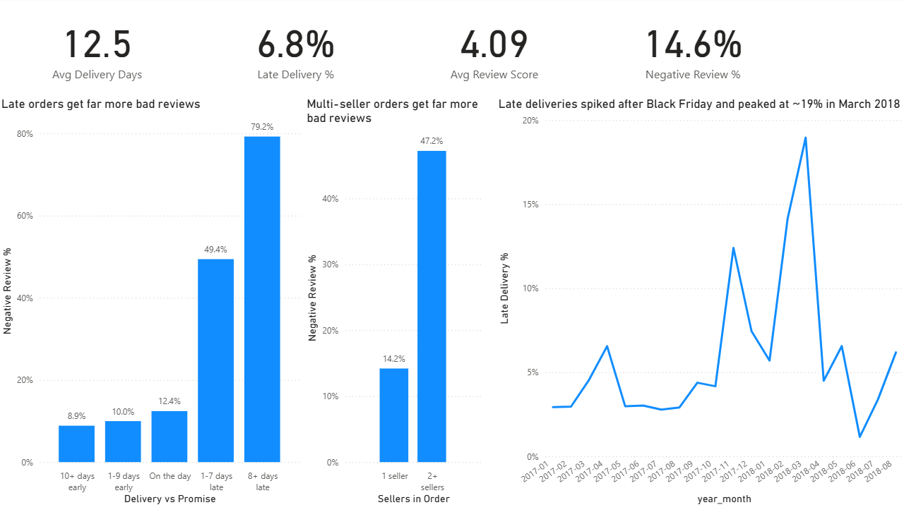
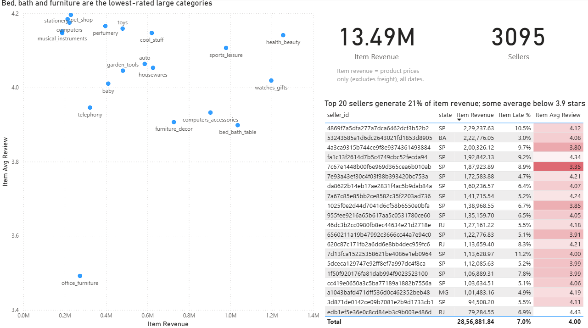

# E-commerce Analytics & Customer Segmentation

An end-to-end analytics project on **~100,000 real orders** from Olist, a Brazilian online marketplace (2016–2018): a tested **dbt + DuckDB** star-schema warehouse, **SQL** analysis of growth, retention, delivery and sellers, **RFM + K-Means** customer segmentation, an **at-risk order model**, and a 4-page **Power BI** dashboard.

**Stack:** SQL · dbt · DuckDB · Python (pandas, scikit-learn, matplotlib, seaborn) · Power BI (DAX) · Git



---

## Key findings

| Question | Answer |
| --- | --- |
| **1. How fast is revenue growing?** | Revenue grew **140% year on year** (R\$3.57M in Jan–Aug 2017 → R\$8.59M in Jan–Aug 2018), driven entirely by order volume: average order value stayed flat at R\$147–174. Growth then **plateaued at ~R\$1.1M a month** through 2018. |
| **2. Do customers come back?** | Almost never. **96.9% of customers ordered only once**, and only **1.3% reorder within 90 days**. Growth depends entirely on acquisition. |
| **3. Which customers should marketing target?** | Two high-value segments are **30% of customers but 56% of revenue**. K-Means also finds **14,568 unhappy customers** (average review 1.46) hidden across every RFM segment, who should be routed to customer service, not promotions. |
| **4. Does late delivery hurt satisfaction?** | Sharply. The bad-review rate jumps from **~10% for on-time orders to 49% when 1–7 days late and 79% when 8+ days late**. Late orders are 6.7% of reviewed orders but cause about **a third of all bad reviews**. |
| **5. How dependent are we on top sellers?** | Highly. **129 sellers (4.2%) generate 50% of revenue**, and 540 (17.7%) generate 80%. |

**A finding the model surfaced:** orders from **two or more sellers get 1–2 star reviews 47% of the time, 5.2x the single-seller rate**. Multi-item orders are 10% of orders but ~26% of bad reviews.

---

## Architecture



1. **Load** – `src/load_raw.py` copies the 9 Kaggle CSVs, untouched, into a `raw` schema in DuckDB.
2. **Transform** – dbt builds three layers: **staging** (clean and cast, one model per source), **intermediate** (aggregate items and payments to one row per order) and **marts** (the star schema).
3. **Test** – **29 dbt tests**: uniqueness, not-null, accepted values, referential integrity, and a custom test that reconciles total revenue between layers to catch join fan-out.
4. **Analyse** – four notebooks query the marts directly.
5. **Report** – marts are exported to Parquet and modelled in Power BI.

### Star schema

| Model | Grain (one row per) | Used for |
| --- | --- | --- |
| `fct_orders` | Order | Revenue, delivery, reviews, the model |
| `fct_order_items` | Item in an order | Category and seller analysis |
| `dim_customers` | Real customer (`customer_unique_id`) | Retention, segmentation, maps |
| `dim_products` | Product | Category (English) |
| `dim_sellers` | Seller | Seller location |
| `dim_date` | Calendar day | Power BI time intelligence |
| `agg_cohort_retention` | Cohort × month | Cohort matrix in Power BI |

---

## Data quality log

Profiling (`notebooks/01_profiling.ipynb`) found several traps that would silently corrupt results:

| Issue | Evidence | Decision |
| --- | --- | --- |
| `customer_id` is per order, not per person | 99,441 `customer_id` vs 96,096 `customer_unique_id` | Use `customer_unique_id`; `customer_id` would show a 0% repeat rate |
| Very low repeat rate | 96.9% of customers ordered once | Model bad reviews instead of churn |
| Duplicate reviews | 99,224 review rows for 98,673 orders | Keep the latest review per order |
| Payments and items fan out | 2,936 multi-payment orders | Aggregate to one row per order before joining; revenue = price + freight |
| Inconsistent delivery dates | 8 delivered orders without a date | Exclude from delivery metrics only |
| Missing categories | 610 products uncategorised; 2 untranslated categories | Fall back to Portuguese name, then `unknown` |
| Duplicate coordinates | 1,000,163 geolocation rows for 19,015 zip prefixes | Average to one point per prefix |
| Sparse edge months | 329 orders in 2016; 20 in Sep–Oct 2018 | Trend analysis uses Jan 2017–Aug 2018 |

---

## Analysis (SQL)

`notebooks/02_analysis.ipynb` answers questions 1, 2, 4 and 5 using window functions (`LAG`, running totals, `FIRST_VALUE`, ranking), cohort analysis and conditional aggregation.

| | |
| --- | --- |
|  |  |
|  |  |

---

## Customer segmentation

`notebooks/03_segmentation.ipynb` compares a rule-based **RFM** segmentation with **K-Means** clustering. Because 96.9% of customers ordered once, frequency is used as a repeat/one-time flag rather than the usual quintile score.

| RFM segment | Customers | % revenue | Recommended action |
| --- | --- | --- | --- |
| New, high value | 14,641 (15.4%) | 28.2% | Second-purchase incentive in the same category |
| Lost, high value | 13,999 (14.7%) | 27.5% | One targeted win-back offer, then stop |
| Needs attention | 18,378 (19.3%) | 17.8% | Low-cost reminder email |
| Hibernating | 22,966 (24.2%) | 10.6% | Exclude from paid campaigns |
| New, low value | 22,118 (23.3%) | 10.3% | Cross-sell bundles, free-shipping threshold |
| Loyal, lapsing | 1,651 (1.7%) | 3.1% | Personalised win-back offer |
| Champions | 1,237 (1.3%) | 2.5% | Early access and referral programme |

**Choosing k:** the silhouette score peaked at k = 2 (0.627), but that split only separates repeat from one-time buyers. The elbow flattens at **k = 5** with almost no loss in silhouette, giving more actionable groups. The clusters agree with RFM on structure, but add one group RFM cannot see: **14,568 unhappy customers** (15.3%, average review 1.46) spread across every RFM segment.

---

## At-risk order model

`notebooks/04_model.ipynb` predicts, at delivery, whether an order will receive a 1–2 star review, so customer service can contact the riskiest orders first.

- **No leakage:** only features known at delivery; review scores and dates are never features.
- **Time-based split:** trained on orders before April 2018 (59,784), tested on April–August 2018 (31,064).
- **Two models in pipelines:** logistic regression and gradient boosting, with class weighting for the 9% positive rate.

| Model | ROC AUC | PR AUC |
| --- | --- | --- |
| Random guessing | 0.500 | 0.087 |
| Logistic regression | 0.661 | 0.196 |
| Gradient boosting | 0.645 | 0.202 |

**Business result:** contacting the **top 10% riskiest orders reaches an unhappy customer 25% of the time (2.9x the base rate) and catches 29% of bad reviews**.

**A design correction:** filtering to reviews written after delivery removed 75% of late orders, because Olist sends the survey around the *promised* date and late customers review before their parcel arrives. About 3,600 of ~4,000 bad reviews on late orders are written before delivery. The recommended strategy is therefore two-part: **contact every order the day it misses its promised date** (62% would otherwise leave a bad review), and **use the model for orders delivered on time**.



---

## Power BI dashboard

Four pages built on the same star schema, with DAX measures for revenue, time intelligence (month-over-month, year-over-year), retention and delivery KPIs. [Full PDF](dashboard/olist_dashboard.pdf)

| | |
| --- | --- |
|  |  |
|  |  |

---

## Repository structure

```text
olist-ecommerce-analytics/
├── src/
│   ├── load_raw.py            # CSVs -> DuckDB raw schema
│   └── export_marts.py        # marts -> Parquet for Power BI
├── olist_dbt/                 # dbt project: staging, intermediate, marts, tests
├── notebooks/
│   ├── 01_profiling.ipynb     # data quality
│   ├── 02_analysis.ipynb      # Q1, Q2, Q4, Q5
│   ├── 03_segmentation.ipynb  # Q3: RFM + K-Means
│   └── 04_model.ipynb         # at-risk order model
├── reports/figures/           # charts used in this README
├── dashboard/                 # Power BI file, PDF and screenshots
└── requirements.txt
```

## How to run

Requires Python 3.11 and the [Olist dataset](https://www.kaggle.com/datasets/olistbr/brazilian-ecommerce) unzipped into `data/raw/`.

```bash
python -m venv .venv
.venv\Scripts\activate            # macOS/Linux: source .venv/bin/activate
pip install -r requirements.txt

python src/load_raw.py            # load raw CSVs into DuckDB
cd olist_dbt && dbt build && cd ..   # build and test the warehouse
jupyter lab                       # run notebooks 01 to 04 in order
python src/export_marts.py        # then open dashboard/olist_dashboard.pbix
```

## Limitations and next steps

- About two-thirds of bad reviews come from causes the data cannot see (product quality, wrong items), which caps model accuracy.
- The split-shipment explanation for multi-seller bad reviews is a hypothesis; **NLP on the Portuguese review comments** would test it.
- **Seller-history features** (each seller's past late rate and reviews, computed without leakage) would likely improve the model.

## Data

[Brazilian E-Commerce Public Dataset by Olist](https://www.kaggle.com/datasets/olistbr/brazilian-ecommerce), published on Kaggle by Olist. See the Kaggle page for the licence. Raw data is not included in this repository.

---

**Om Juvekar** · MSc Computer Science (Data Science), Trinity College Dublin · [LinkedIn](https://www.linkedin.com/in/om-juvekar-5054b5297/)
